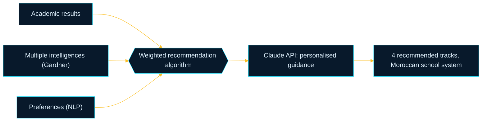

  

 

## `01 //` My career, as a git history

  

 

> **I treat every dataset like a story waiting to be told, and every problem like a system waiting to be designed.**
>
> I hold a **DUT in Data Engineering** from the *École Supérieure de Technologie d'El Kelaâ des Sraghna* (Morocco). I combine **data analysis**, **application development** and **AI** to build things people actually use, like an orientation platform presented to a provincial education authority.
>
> I'm rigorous, curious, and I want to take the next step in an **international Data Science program**, to work on projects with real impact.

 

## `02 //` My stack, as a database

  

<i>Because a data engineer shouldn't list her skills in a bullet list. Everything links back to one `profile`.</i>

  

## `03 //` Featured project: My Future IA

A **bilingual (French / Arabic)** web app that helps 9th-grade students (3ème année du collège) choose their educational track. Built with **React 18** during my internship at the **Provincial Directorate of Education (DPENPS)** of El Kelaâ des Sraghna, and presented to its officials.

<table>
<tr>
<td width="50%" valign="top">

### SmartHealth
`Final-year project` `Health monitoring`

An intelligent **health-tracking application** integrating a digital monitoring solution. My capstone project for the DUT (2025–2026).

</td>
<td width="50%" valign="top">

### LotisManager
`Python` `Data structuring` `Automation`

Automated **classification of land subdivisions** for the Municipality of El Kelaâ des Sraghna: structured the land databases, automated sorting and categorization, and contributed to digitizing administrative data.

</td>
</tr>
</table>

 

## `04 //` Next destination

  

 

- Looking for an **international program (Master's)** in **Data Science / AI**
- Eager to work on projects where data creates **real-world impact**
- Always learning, always shipping

| Arabic | French | English |
|:---:|:---:|:---:|
| Native | B2 | A2 |

 

## `05 //` GitHub telemetry

 

## `06 //` Let's connect

<i>Data is the starting point, impact is the destination.</i>

